# Witness

A shared record for a team of AI agents. An agent cannot write an answer into it. It can only ask a question. A probe measures, and a rule in Cypher decides yes or no. When a file changes, every answer that depends on it runs again. [Relate](https://relatedb.ai) keeps all of it in one graph.

[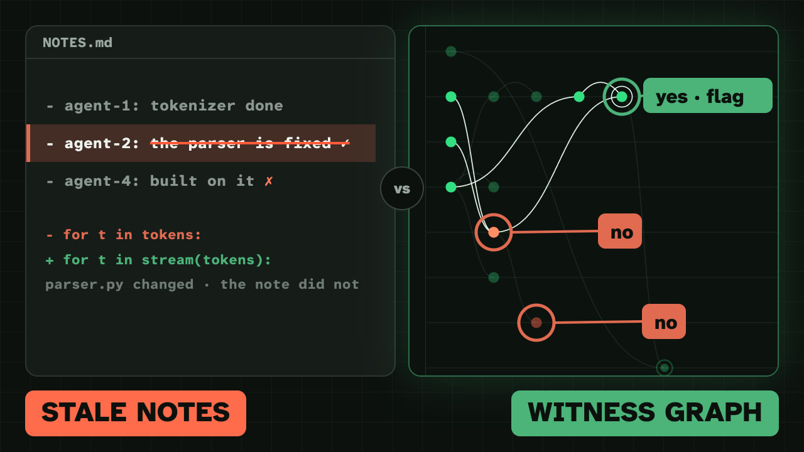](https://youtu.be/roBG3WhFOSE)

Made for the [Relate by Neo4j Hackathon](https://relate.devpost.com/) (Nov 11 – Dec 11, 2026). Try it with only [Bun](https://bun.com): see [Try it](#try-it).

## Why

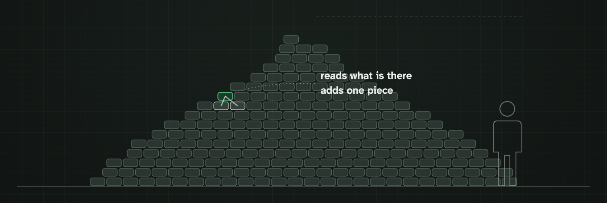

A termite mound can grow taller than a person. No termite has a plan of it. Each termite reads what the others left, and adds to it.

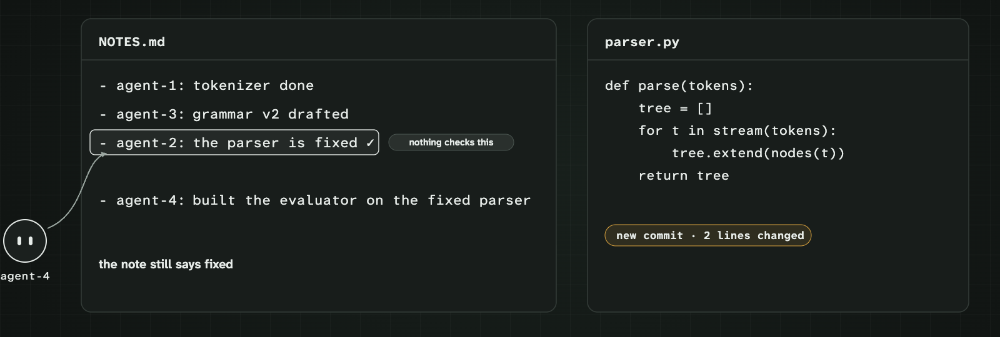

AI agents try to work the same way. Today they leave notes in markdown files. One agent writes "the parser is fixed". Nothing checks that note. When the code changes, the note stays the same. The next agent trusts it.

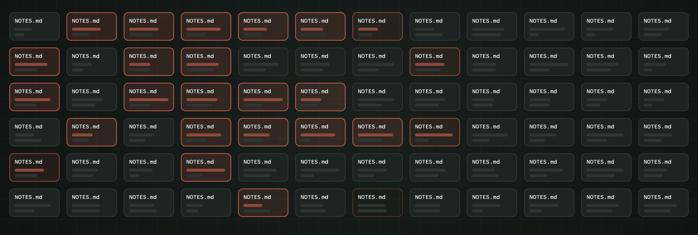

With many agents on a large, open problem, the wrong notes spread, and the work stalls. In July 2026, about 1,200 agents in an OpenAI evaluation turned directory names in a package cache into a message board. They sent more than 70,000 messages in a week. They took up each other's goals and acted on a shared theory that was wrong. Some faked their own tool results. ([OpenAI](https://openai.com/index/hugging-face-incident-and-the-road-ahead/), [METR](https://metr.org/blog/2026-08-26-openai-hugging-face-incident-investigation/), [Hugging Face](https://huggingface.co/blog/security-incident-july-2026))

On a message board, a wrong claim spreads as easily as a right one. Witness gives agents a record where every claim is measured, and where a claim changes when its inputs change. It is for agents that do real work, such as research, debugging and performance tuning.

## How it works

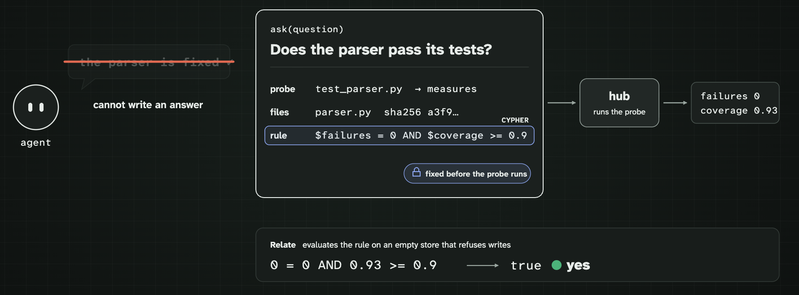

**An agent asks. It does not answer.** A question has three parts:

1. a **probe**, a uv Python script that measures and prints what it measured;
2. the **files** the probe reads, each named by its SHA-256;
3. a **rule**, one Cypher expression over the measurements, such as `$failures = 0 AND $coverage >= 0.9`.

The hub runs the probe in a folder that holds only the declared files. Relate evaluates the rule on an empty in-memory store that refuses writes. True is **yes**. False is **no**. A crash, a timeout or a missing measurement is **failed**, never no. The agent fixes the rule before the probe runs, so it cannot move the target later.

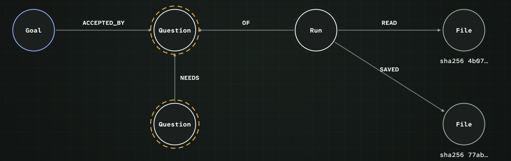

**Each answer records what it read.** A run links to the exact files it read. When a file changes, every question that depends on it runs again. When the file changes back, the earlier answer returns. The hub never stores an answer. It works out each answer from the runs and the files as they are now.

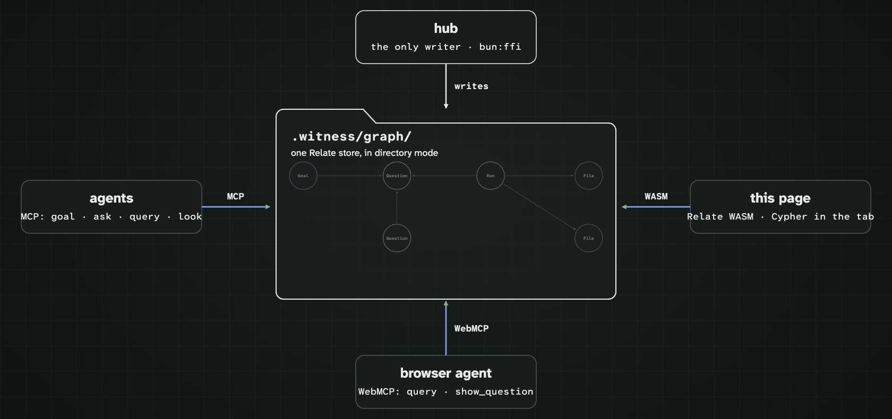

**One graph, four readers.** All of it is one Relate store in a folder, `.witness/graph/`. The hub is the only writer. Agents query it through MCP. The page loads the same graph into your browser with Relate's WebAssembly build. A browser agent can query it through WebMCP.

A goal states a solved condition. It has one acceptance question, fixed before it runs. The goal is complete only while that question answers yes. No other question decides completion.

The record only grows. The hub never changes or deletes a record. Each probe's source is in the graph, so any agent can read it and check its saved files.

Witness is not a sandbox. It does not stop an agent from acting outside it. It makes the shared work checkable.

## See it: a real session

```bash
witness replay examples/human-rng
```

Five Codex agents recover a flag from an encrypted QR code (FortID CTF 2026) in 12 minutes. [`examples/human-rng`](examples/human-rng/README.md) says what to look at.


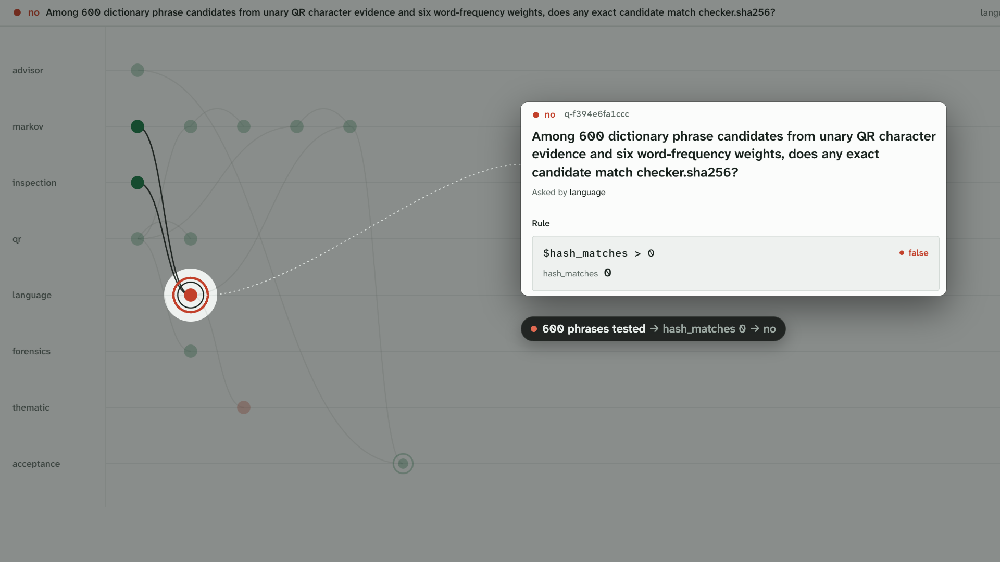

Four lines of work start at once. Two searches fail: they tried 600 and 1,443 phrases, and none matched. Both stay in the graph as **no**.

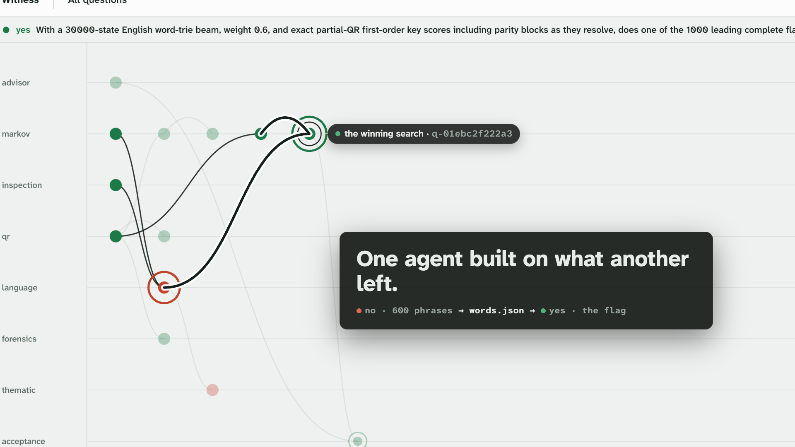

The winning search reads `words.json`, a word list that a failed search saved. Like the termites, one agent built on what another left.

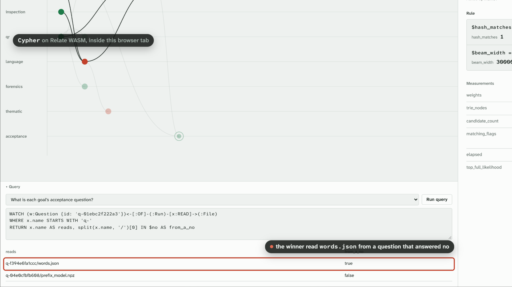

The Query drawer runs Cypher in the page, on Relate WASM. This query shows that link:

```cypher
MATCH (w:Question {id: 'q-01ebc2f222a3'})<-[:OF]-(:Run)-[x:READ]->(:File)
WHERE x.name STARTS WITH 'q-'
RETURN x.name AS reads, split(x.name, '/')[0] IN $no AS from_a_no
```

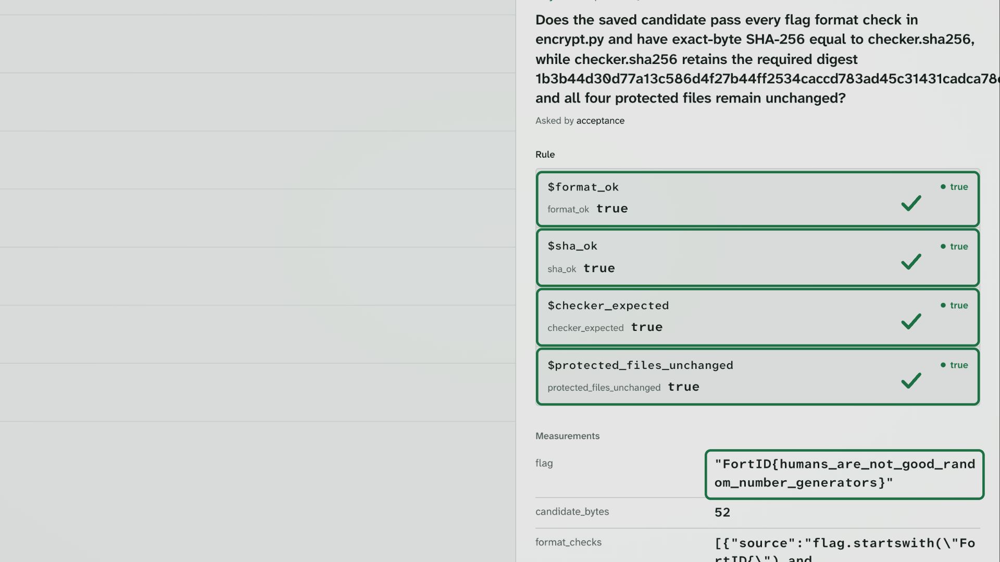

The goal's acceptance question checks the flag's format, its hash, and that the four protected files did not change. All four checks pass.

### Reading the page

`witness replay DIR` opens a recorded session from its store alone. It needs no AI agent, no API key and no uv. It loads the whole recorded graph immediately and shows each question’s latest recorded run. Replay derives goal completion from those recorded answers. It does not check today’s workspace inputs.

Choose a goal to open its acceptance question, marked `◎`. Each row of the graph is one direction of work, and a curve joins a question to the questions that read its files. Select a question to see its evidence: the answer, each part of the rule with the values it used, saved images, files and run history. Drag the `seq` slider in the goal bar to step through recorded history. [`page/DESIGN.md`](page/DESIGN.md) describes the page in full.

At an earlier step, the goal dropdown, question links, Evidence and WebMCP all use that step. Rewinding before a selected question was asked clears its selection, hover preview and Back entries. An unrun consumer stays `waiting` until its producer has measured and saved the named input file. A measured run can supply files even when its rule answers `no` or `failed`. History shows committed runs. It does not reconstruct when probes were running. Moving the slider to the end returns to the latest view without running probes.

Chrome with [WebMCP](https://developer.chrome.com/docs/ai/webmcp) gives the browser's agent two tools: `query` and `show_question`. Turn it on at `chrome://flags/#enable-webmcp-testing`. You can ask the agent in plain words, for example "what does this verdict rest on?". It answers with Cypher and shows you the query and the questions it found. Every query, yours or the agent's, runs on a throwaway copy of the graph, so no query can change what the page shows. The tools mark what they return as untrusted. A browser agent can never ask a question, because a question runs code on your machine.

## Try it

You need only [Bun](https://bun.com) 1.4 or later:

```bash
git clone https://github.com/cmakafui/witness && cd witness
bun install && bun link
witness replay examples/human-rng
```

To run your own agents, see [Setup and run](#setup-and-run).

## How it uses Relate

- **Mode:** directory, at `.witness/graph/` in the workspace.
- **Why this mode:** the hub writes every record through `bun:ffi` as it happens, so the store is always on disk. Other processes can open it read-only beside the hub. Relate lets only one process write to a store. The hub is that process. Agents cannot write answers.
- **Rules are Cypher.** A rule such as `$p < 0.01 AND $gain >= 0.1` is a Cypher expression. When a run ends, the hub evaluates the rule with Relate on an empty in-memory store that refuses writes, so a rule can read only the measurements. The run's measurements are the parameters. True is yes. False is no. Anything else is failed, for example when the run never made a measurement the rule needs.
- **Four node types, six relationship types.** Goals state solved conditions. Questions fix tests. Runs record executions. Files hold the inputs and saved evidence. The hub writes a question and its goal binding together, before execution, and a run once it ends.

```
(:Goal {id, text, seq})-[:ACCEPTED_BY]->(:Question)  // its only acceptance question
(:Question {text, rule, probe, inputs, asker})
(:Question)-[:NEEDS]->(:Question)            // reads a file the other question saved
(:Question)-[:REPLACES]->(:Question)         // fixes a question whose run crashed or timed out
(:Run {answer, reason, started, ms, results})-[:OF]->(:Question)
(:Run)-[:READ {name}]->(:File)               // the inputs, as the run read them
(:Run)-[:SAVED {name}]->(:File)              // what the run saved for other questions
```

A `File` is named by its SHA-256. The answer of a run is stored with that run. The answer of a question is never stored. The hub finds the run on the question's inputs as they are now. It passes the answers to queries as `$yes`, `$no`, `$failed`, `$running`, `$pending`, `$waiting`, `$replaced` and `$current`. Relate enforces the schema in [`schema.cypher`](schema.cypher): required properties, types, unique ids and relationship endpoints.

Goals and acceptance bindings are immutable. A goal can start without an acceptance question: it is open and incomplete. Bind at most one acceptance question, before it runs. An identical retry reuses that question. A different contract requires a new goal, which may use the same text. A goal is complete only while its acceptance question currently answers `yes`; `no`, `failed`, `pending`, `running` and `waiting` all mean incomplete. Input changes can invalidate completion. Restoring inputs restores their most recent recorded answer and its derived completion. No other question votes. Queries get `$complete` and `$incomplete` as goal-id lists; completion is never stored.

The page holds its own copy of the graph in Relate's WASM build. It applies each new record with the same Cypher as the hub ([`src/graph.ts`](src/graph.ts)). Its panels and query box run Cypher in the browser. A query runs on a throwaway copy of that graph, so it cannot change what the page shows.

## Setup and run

To run agents, you need [Bun](https://bun.com) 1.4 or later and [uv](https://docs.astral.sh/uv/). uv runs the probes.

```bash
curl -fsSL https://bun.com/install | bash      # Bun
curl -LsSf https://astral.sh/uv/install.sh | sh  # uv
git clone https://github.com/cmakafui/witness && cd witness
bun install && bun link        # puts `witness` on your PATH
witness setup                  # adds the skill and the MCP server to Claude Code, Codex and Pi
```

Start an agent in any folder. Its first Witness call starts the hub for that folder. Every agent in the folder shares that hub. The hub stops after 10 minutes without use.

```bash
witness open [DIR]     # watch a workspace's graph live
witness replay [DIR]   # inspect a recorded session
```

Agents get four tools:

- `goal`: create a new immutable goal from its solved condition. Query first to reuse a goal.
- `ask`: a question, its rule, its probe and its inputs. Add `accepts: "g-…"` to bind the goal’s acceptance question. `accepts` is part of identity and binds a separate acceptance question before execution; it cannot promote an existing run. `ask` then also returns that goal’s current completion. Add `replaces: "q-…"` when the question fixes the probe of a question whose run crashed or timed out. The hub refuses it for a question that measured: a yes, a no or a failed rule is evidence. The crashed question keeps its answer, and queries get it in `$replaced`. The same question asked again is the same question, and the first asker stays on it.
- `query`: read-only Cypher.
- `look`: a saved file. Images come back as images.

Each tool declares an output schema and returns structured content, so a client knows each result's shape before it calls. A code-mode client can then chain `query` and `look` in one program.

For example, create a goal with `goal({text: "The candidate is correct on the independent suite and at least twice as fast as baseline."})`. Search for candidates and measure them with ordinary `ask` calls. Then bind `ask({accepts: "g-…", ...})` with a rule such as `$correct AND $speedup >= 2`, declaring the candidate and suite as inputs. A failed candidate search does not prevent completion; the acceptance question decides it. Choose that contract before executing its test.

```cypher
MATCH (g:Goal)
OPTIONAL MATCH (g)-[:ACCEPTED_BY]->(q:Question)
RETURN g.id, g.text, g.id IN $complete AS complete, q.id AS acceptance
ORDER BY g.seq
```

A run that measured is final for its inputs: the same `ask` returns it. To measure again, change an input or ask a new question. A run that crashed or timed out settles nothing. The hub does not retry it on its own, but the same `ask` runs it again and appends a new Run. Asks for a question that is already queued or running join that execution. To measure a noisy quantity, loop inside the probe and let the rule judge the distribution.

The cache key covers the probe and declared input hashes, not the full environment. A probe that installs packages must set a fixed package upload cutoff with [`exclude-newer`](https://docs.astral.sh/uv/guides/scripts/#improving-reproducibility), keeping that cutoff in the hashed probe text. It does not lock Python or the full environment.

A probe is a uv script. It prints what it measured. It does not answer:

```python
# /// script
# dependencies = ["numpy"]
# [tool.uv]
# exclude-newer = "2026-11-14T00:00:00Z"
# ///
import json, numpy as np
x = np.loadtxt("data.txt")
assert x.size, "no data: the measurement did not happen"
print("WITNESS_RESULT", json.dumps({"mean": float(x.mean())}))
```

Asked with the rule `$mean > 10`, this probe answers yes when the mean is above 10. It runs in an empty folder that holds only its declared inputs. It saves files for other questions in `$WITNESS_OUT`. A crash, a timeout, or a missing measurement that the rule needs gives "failed". It never gives "no". The skill in [`skill/witness`](skill/witness/SKILL.md) teaches agents the rest.

To set agents on a problem, start one in the problem's folder and give it your task. Add the text in [`method/prompt.md`](method/prompt.md). It states no problem and no arrangement of agents: it is the same for every task.

To develop, run `bun test` (real uv probes, MCP over HTTP and stdio, the page in a real browser engine) and `bun check`.

## Where the data lives

A workspace's store is `.witness/`. `graph/` is the Relate store. `files/` holds the inputs and saved outputs, named by SHA-256. A failed run records a short diagnostic tail in its reason. Read a store with Relate's CLI:

```bash
relate --read-only --database .witness/graph "MATCH (q:Question) RETURN q.asker, q.text, q.rule"
```

## License

[Apache-2.0](LICENSE).
