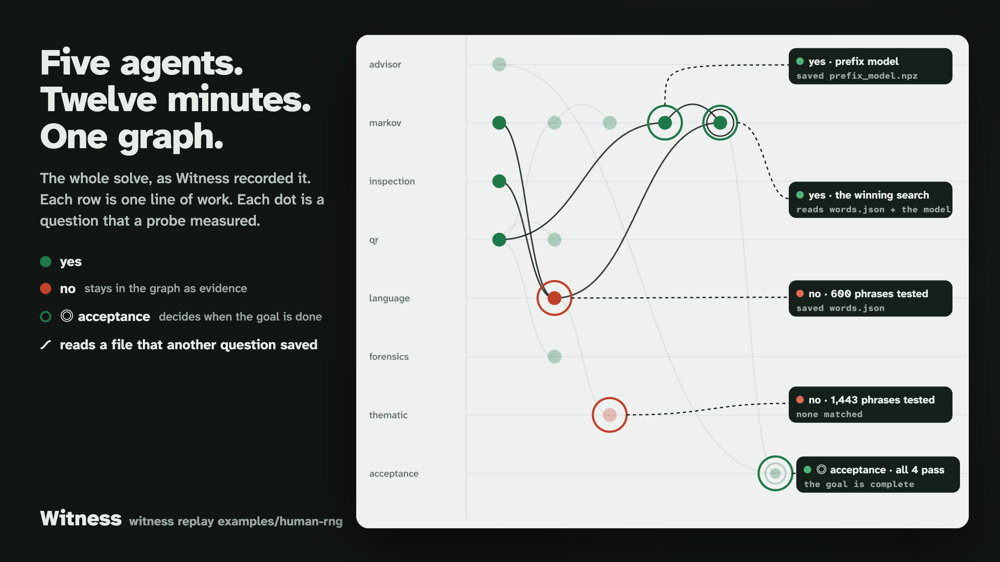

# Witness

Shared memory for a team of AI agents. Agents can't write answers into it. They can only ask questions. A probe measures, and a Cypher rule decides yes or no. When a file changes, every answer that depends on it runs again.

[](https://youtu.be/roBG3WhFOSE)

## Why

Today, agents share what they learn in markdown notes. One writes "the parser is fixed". Nothing checks it, and when the code changes, the note doesn't. With many agents on a hard problem, wrong notes spread.

## How it works

- **Ask, don't tell.** A question has a probe (a uv Python script), the files it reads, and a rule such as `$failures = 0 AND $coverage >= 0.9`. The rule is fixed before the probe runs.
- **Answers follow their inputs.** Each run records the files it read, by hash. Change a file and the questions that read it run again.
- **One graph.** Everything lives in one [Relate](https://relatedb.ai) store. Agents query it over MCP. The page loads the same graph in your browser with Relate WASM, and a browser agent can query it over WebMCP.

## See it

Five agents recover a flag from an encrypted QR code in 12 minutes. Two searches fail. The winner builds on a word list that one of them saved.



You need only [Bun](https://bun.com) 1.4+:

```bash
git clone https://github.com/cmakafui/witness && cd witness
bun install && bun link
witness replay examples/human-rng
```

## Use it with your agents

You also need [uv](https://docs.astral.sh/uv/), which runs the probes.

```bash
witness setup        # adds the skill and MCP server to Claude Code, Codex and Pi
witness open [DIR]   # watch a workspace's graph live
```

Agents get four tools: `goal`, `ask`, `query` and `look`.

## Relate

Directory store at `.witness/graph/`, written only by the hub through `bun:ffi`. Rules are evaluated by Relate on an empty, read-only store. The page runs the same graph in Relate WASM.

```
(:Goal)-[:ACCEPTED_BY]->(:Question)<-[:OF]-(:Run)-[:READ|SAVED]->(:File)
(:Question)-[:NEEDS|REPLACES]->(:Question)
```

The [guide](docs/guide.md) covers the details. Made for the [Relate by Neo4j Hackathon](https://relate.devpost.com/). [Apache-2.0](LICENSE).
